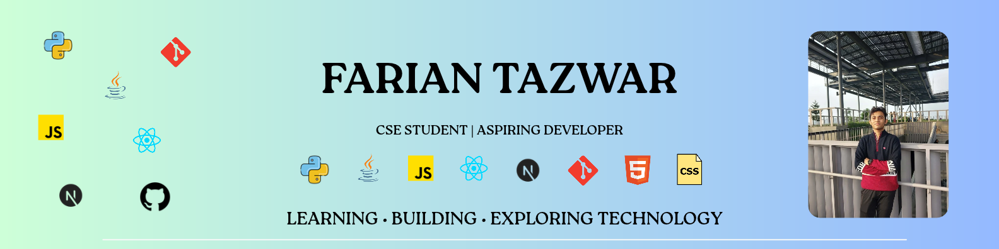

  

  

## 💫 About Me

- 🎓 Pursuing **B.Sc. in Computer Science & Engineering** at **[BRAC University](https://www.bracu.ac.bd/)**
- 🌐 Check out my portfolio: **[farian-portfolio-theta.vercel.app](https://farian-portfolio-theta.vercel.app/)**
- 🌱 Currently mastering **Full-Stack Web Development** & Modern Web Architectures
- 👨‍💻 All of my public projects are available at **[@farian2006](https://github.com/farian2006?tab=repositories)**
- 💬 Ask me about **JavaScript, Python, React, Next.js & UI/UX Design**
- 📫 Reach out to me directly: **[fariantazwar@gmail.com](mailto:fariantazwar@gmail.com)**

  
  
  
  

---

## 💻 Tech Stack

### 🚀 Languages & Core

  

### ⚛️ Frameworks & Web Tech

  

### 🛠️ Tools, Platforms & Design

  
  

---

## 📊 GitHub Analytics & Streak

  
  

  
  

---

## ✍️ Random Dev Quote

  

---

  ⭐ <i>Thanks for visiting my profile! Feel free to explore my repos and reach out to collaborate.</i> ⭐

